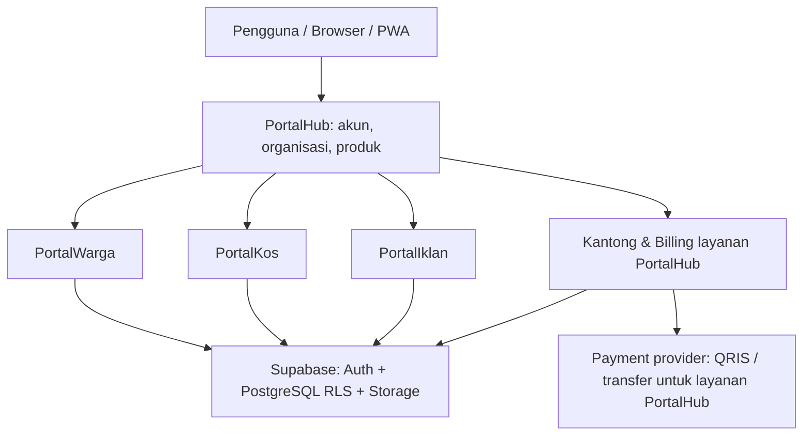
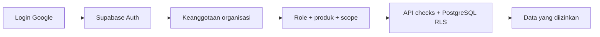

# PortalHub

**Satu akun. Banyak organisasi. Tiga produk terintegrasi.**

PortalHub adalah rancangan ekosistem **SaaS multi-tenant** untuk pengelolaan lingkungan warga, properti sewa, dan iklan publik. Organisasi menggunakan produk yang dibutuhkan, sementara identitas, manajemen hak akses, langganan, dan pembayaran layanan dikelola secara terpusat.

> **Status proyek:** fase dokumentasi & perencanaan implementasi — **belum merupakan aplikasi PortalHub yang siap dijalankan**.  
> **Baseline spesifikasi:** 19 November 2026 · [Baca keputusan produk](docs/00-product/Decisions.md) · [Indeks dokumentasi lengkap](docs/README.md).

## Ekosistem produk

| Produk | Pengguna utama | Kemampuan utama |
| --- | --- | --- |
| **PortalHub Core** | Pemilik organisasi, admin, billing manager | Satu akun, multi-organisasi, manajemen pengguna, kebijakan aktivasi, subscription, paket, Kantong |
| **PortalWarga** | Pengurus, bendahara, panitia event, warga | Rumah & penghuni, IPL, kas operasional, event dengan **kas terpisah**, laporan, pengumuman, dokumen |
| **PortalKos** | Pemilik kos, pengelola, staf, penyewa | Banyak properti per organisasi, kamar/unit, kontrak, tagihan, pencatatan pembayaran, laporan, iklan kamar kosong |
| **PortalIklan** | Pengiklan & masyarakat umum | Katalog iklan usaha/properti, pencarian, detail publik SEO-friendly, moderasi, kuota & masa tayang |

**PortalIklan merupakan kanal iklan dan penemuan, bukan perantara transaksi pembeli dan penjual.** Integrasi iklan diprioritaskan ke **PortalKos terlebih dahulu**, kemudian **PortalWarga**; pemasang iklan umum dapat dibuka setelah sistem matang.

## Gambaran arsitektur



**Arah teknis (rancangan, belum diimplementasikan):**

- **Aplikasi privat / PWA:** React, Vite, Tailwind CSS; desktop menampilkan informasi lebih lengkap, mobile lebih ringkas dan informatif.
- **PortalIklan publik:** frontend berkemampuan SSR/SSG seperti Next.js untuk halaman yang dapat diindeks mesin pencari.
- **Backend:** Supabase Auth, PostgreSQL dengan RLS, Storage, serta endpoint server tepercaya untuk transaksi sensitif.
- **Arsitektur:** modular monolith dengan domain terpisah, satu identitas bersama, dan pemisahan akses per organisasi.
- **Hosting target:** Vercel; integrasi penyedia pembayaran dan detail produksi **belum ditetapkan**.

Rincian dan diagram teknis tersedia di [Architecture.md](docs/Architecture.md) dan [Data Model](docs/03-data/Data-Model.md).

## Login, organisasi, dan hak akses

**Metode login utama adalah Google OAuth melalui Supabase Auth.** Opsi email OTP / magic link dapat disediakan melalui konfigurasi.



Supabase Auth mengautentikasi pengguna; **PostgreSQL RLS mengotorisasi akses data**, bukan melakukan login. Berhasil login **tidak otomatis** memberi akses ke organisasi atau data warga/penyewa.

- Satu pengguna bisa bergabung di beberapa organisasi dengan peran berbeda pada tiap produk.
- Pengelola kos dapat dibatasi pada properti tertentu; panitia event hanya pada event yang ditugaskan.
- **Kebijakan onboarding Hybrid (default):** PortalKos self-service, sedangkan PortalWarga memerlukan verifikasi kewenangan sebelum akses sensitif. Kebijakan bisa diubah oleh admin yang berwenang dengan audit dan guardrail wajib.
- Warga/penyewa boleh tercatat sebagai penghuni tanpa harus langsung membuat akun login.

Baca [RBAC](docs/04-security/RBAC.md) dan [Security & Privacy](docs/04-security/Security-Privacy.md).

## Prinsip keuangan: pencatatan dipisahkan dari pembayaran platform

| Aktivitas | Apa yang PortalHub lakukan? |
| --- | --- |
| IPL warga, iuran & kas event | **Mencatat** pembayaran tunai/transfer, bukti opsional, verifikasi internal, laporan |
| Sewa kos & deposit jaminan penyewa | **Mencatat** transaksi, bukan menerima atau menyalurkan uang penyewa |
| Jual-beli melalui iklan | Pembeli dan penjual bertransaksi **di luar platform** |
| Subscription, paket, promosi iklan | Memproses **pembayaran layanan PortalHub sendiri** via QRIS/transfer yang tervalidasi |
| Top Up **Kantong** | Mengisi saldo layanan PortalHub setelah pembayaran benar-benar terverifikasi |
| Bayar langsung (*Payment*) | Bayar layanan saat checkout tanpa top-up; alternatifnya isi Kantong sejumlah tagihan terlebih dahulu |

**Kantong** adalah saldo tertutup untuk membeli layanan PortalHub; bukan rekening, escrow, sarana transfer antar pengguna, maupun pembayaran IPL/sewa. Riwayat dipisahkan menjadi **Top Up**, **Transaksi** (pemakaian saldo per fitur/produk), dan **Payment** (bayar langsung). Auto-renew hanya berjalan bila pelanggan mengaktifkannya, saldo cukup, dan sistem mencegah debit ganda.

Kas utama PortalWarga dan kas setiap event memiliki laporan sendiri. Transfer internal antar-kas dicatat berpasangan agar laporan konsolidasi tidak menghitung dua kali.

> **Perhatian:** kebijakan saldo prabayar, refund, pajak, dan kesesuaian dengan regulasi/ketentuan payment provider harus ditinjau sebelum produk pembayaran diluncurkan. Pembayaran IPL/sewa via QRIS yang terdapat pada kode PortalWarga lama **bukan** persetujuan untuk mengaktifkannya di PortalHub.

Baca [Kantong & Payments](docs/05-billing/Kantong-and-Payments.md) dan [Operational Finance](docs/05-billing/Operational-Finance.md).

## Desain aplikasi dan contoh URL

**Desain:** *Clean Minimal × Mobile First × PWA*. Desktop: sidebar, tabel, grafik, filter lengkap. Mobile: kartu ringkas, bottom navigation, informasi prioritas, dan aksi cepat. Halaman publik iklan berorientasi ke SEO, tanpa mengindeks data privat.

Rancangan URL dengan satu domain:

| Area | Contoh path |
| --- | --- |
| Situs utama | `/` |
| Login | `/login` |
| Portal akun, organisasi, subscription, Kantong | `/app` |
| PortalWarga per organisasi | `/warga/:orgSlug/beranda` |
| PortalKos per organisasi | `/kos/:orgSlug/dashboard` |
| PortalKos per properti | `/kos/:orgSlug/properti/:propertySlug` |
| PortalIklan publik | `/iklan` |
| Detail iklan SEO | `/iklan/:kategori/:kota/:slug` |

Contoh domain target pengembangan: `https://portalhub.vercel.app`. Semua path di atas **belum tentu tersedia** sebelum router & deployment dibuat; mengganti URL tidak boleh melewati pemeriksaan izin.

Lihat [Design System](docs/Design-System.md), [Routing & Deployment](docs/02-architecture/Routing-Deployment.md), dan [Routes & Journeys](docs/07-ux/Routes-and-Journeys.md).

## Dokumentasi pengembangan

| Area | Dokumen |
| --- | --- |
| **Indeks seluruh dokumen** | **[docs/README.md](docs/README.md)** |
| Kebutuhan produk & acceptance criteria | [PRD.md](docs/PRD.md) |
| Standar UI, PWA, aksesibilitas | [Design-System.md](docs/Design-System.md) |
| Arsitektur & batas domain | [Architecture.md](docs/Architecture.md) |
| Aturan untuk AI coding agent | [AI-Agents.md](docs/AI-Agents.md) |
| Keputusan produk | [Decisions.md](docs/00-product/Decisions.md) |
| Lingkup MVP dan rilis | [MVP-and-Release.md](docs/01-product/MVP-and-Release.md) |
| ERD & model database | [ERD.md](docs/03-data/ERD.md) · [Data-Model.md](docs/03-data/Data-Model.md) |
| Hak akses & privasi | [RBAC.md](docs/04-security/RBAC.md) · [Security-Privacy.md](docs/04-security/Security-Privacy.md) |
| Pembayaran & pelaporan operasional | [Kantong-and-Payments.md](docs/05-billing/Kantong-and-Payments.md) · [Operational-Finance.md](docs/05-billing/Operational-Finance.md) |
| Spesifikasi produk | [PortalKos](docs/06-products/PortalKos.md) · [PortalWarga](docs/06-products/PortalWarga.md) · [PortalIklan & SEO](docs/06-products/PortalIklan-SEO.md) |
| Alur bisnis | [Workflows.md](docs/02-architecture/Workflows.md) |
| API & operasional | [API-Contract.md](docs/08-operations/API-Contract.md) · [DevOps-Runbook.md](docs/08-operations/DevOps-Runbook.md) |
| Tahapan implementasi & pengujian | [Roadmap.md](docs/09-delivery/Roadmap.md) · [Test-Plan.md](docs/09-delivery/Test-Plan.md) |
| Migrasi dari PortalWarga sebelumnya | [Legacy-Migration.md](docs/02-architecture/Legacy-Migration.md) |
| Catatan keputusan arsitektur | [ADR-0001](docs/10-decisions/ADR-0001-modular-monolith.md) · [ADR-0002](docs/10-decisions/ADR-0002-wallet.md) |

## Struktur repository saat ini

```text
PortalHub/
├── README.md                # Halaman pengantar ini
├── .gitignore
└── docs/
    ├── README.md            # Indeks dokumentasi
    ├── PRD.md
    ├── Design-System.md
    ├── Architecture.md
    ├── AI-Agents.md
    ├── 00-product/
    ├── 01-product/
    ├── 02-architecture/
    ├── 03-data/
    ├── 04-security/
    ├── 05-billing/
    ├── 06-products/
    ├── 07-ux/
    ├── 08-operations/
    ├── 09-delivery/
    ├── 10-decisions/
    ├── contracts/
    └── examples/
```

**Belum ada source code PortalHub di repository ini.** Struktur monorepo `apps/`, `packages/`, dan `supabase/` yang dijelaskan di dokumen arsitektur adalah **usulan target**, bukan folder yang sudah tersedia. Karena itu belum ada perintah `npm install`/`npm run dev` khusus PortalHub yang dapat dijamin berjalan.

## Jalur implementasi yang disarankan

1. Tetapkan baseline domain, keputusan yang masih terbuka, konfigurasi lingkungan, dan cara migrasi legacy.
2. Bangun Supabase Auth (Google OAuth), organisasi, membership, role/scope, RLS, dan policy onboarding.
3. Bangun service orders, subscription, Kantong, pembayaran langsung, webhook & ledger yang idempotent.
4. Kembangkan PortalKos multi-properti dan pencatatan keuangan tanpa payment gateway operasional.
5. Bangun katalog publik PortalIklan berbasis SEO; integrasikan iklan kamar kosong dari PortalKos.
6. Migrasikan PortalWarga secara bertahap, pertahankan pembagian kas event; hubungkan iklan usaha warga.
7. Validasi lewat pengujian isolasi tenant, finansial, keamanan, accessibility, PWA, dan SEO sebelum produksi.

Setiap perubahan implementasi harus mengacu pada [Roadmap](docs/09-delivery/Roadmap.md), [Test Plan](docs/09-delivery/Test-Plan.md), serta [AI-Agents.md](docs/AI-Agents.md). Pembayaran produksi, migrasi data live, dan kebijakan Kantong perlu persetujuan serta review tersendiri.

---

**Referensi kode yang sudah ada:** [kodok-ijho/PortalWarga](https://github.com/kodok-ijho/PortalWarga). Repository tersebut merupakan **legacy/reference** untuk evaluasi reuse; jangan menganggap seluruh implementasinya otomatis memenuhi arsitektur multi-tenant PortalHub.

**Lisensi:** belum ditetapkan dalam repository ini; penetapan lisensi dan hak penggunaan ulang kode harus diselesaikan sebelum distribusi yang membutuhkan izin eksplisit.
