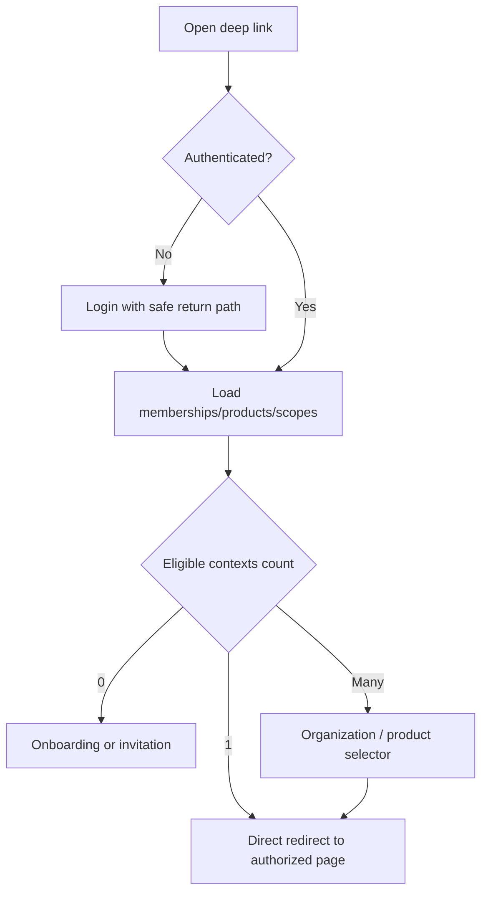
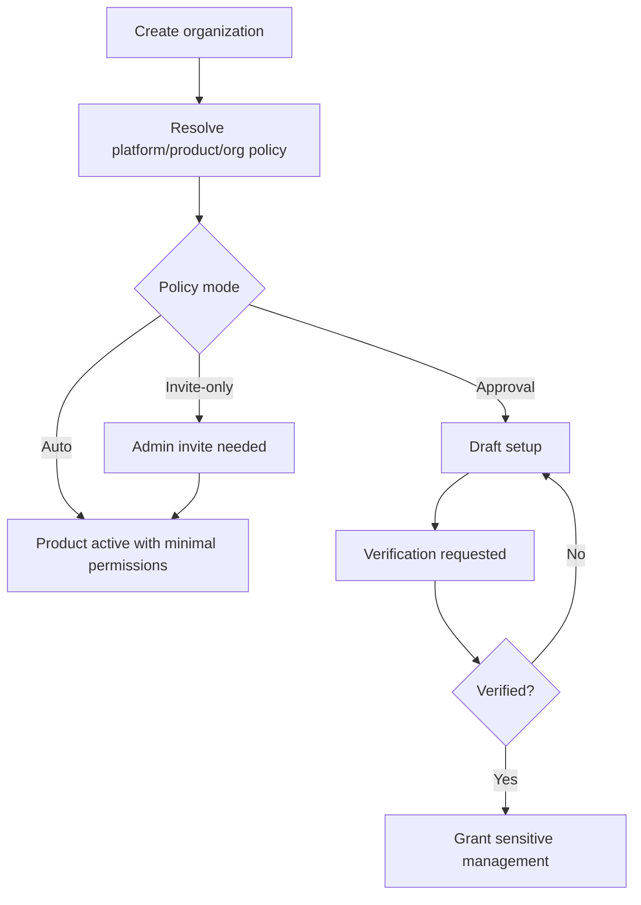
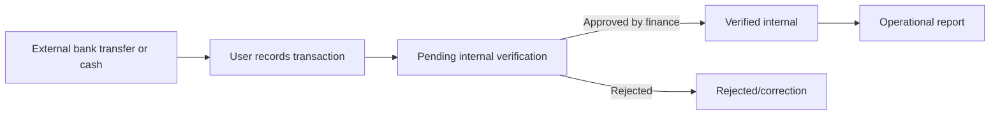
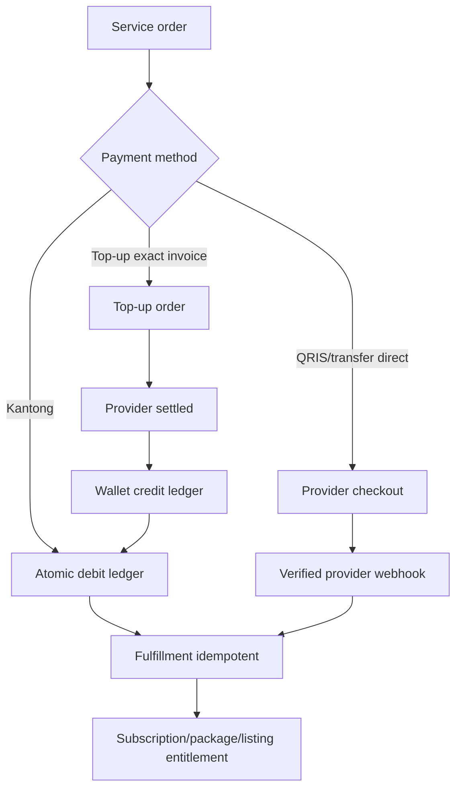
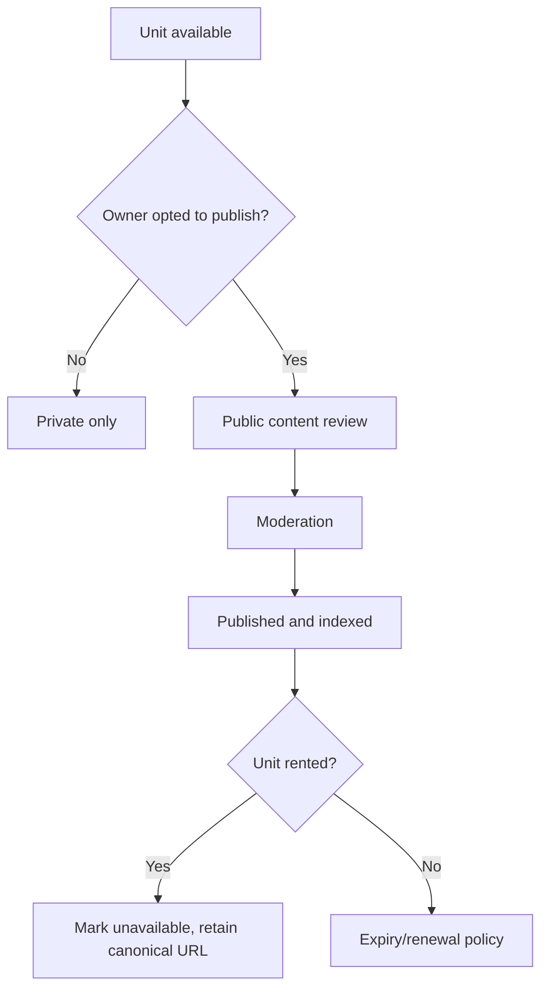

# Workflow bisnis

## Login / pemilihan akses

## Organization activation

## Operational payments

## Services billing

## Kos availability → listing

## Event account transfer

Kas utama --debit transfer--> clearing internal --credit transfer--> kas event. Dua baris yang dipautkan `transfer_id`; dikecualikan dari pendapatan/beban konsolidasi. Semua event reports event_id scoped.
