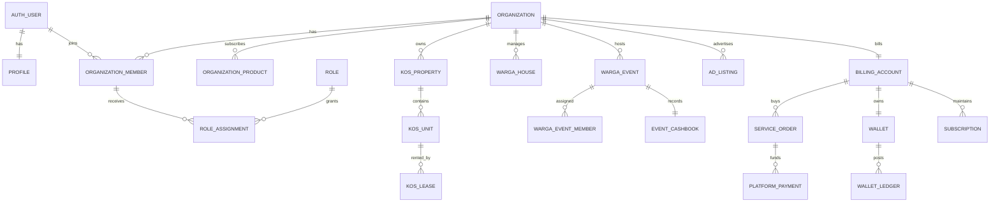
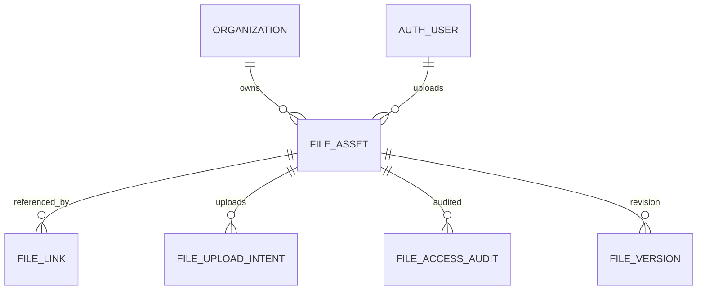

# ERD high-level

Diagram konseptual; migrasi SQL detail harus memperkuat FK tenant, constraints event account, RLS dan unique idempotency.

## ERD — Cloudflare R2 file references

`FILE_ASSET` dan `FILE_LINK` berada di Supabase PostgreSQL/RLS; byte file berada di R2. Referensi payment/event/lease/listing bersifat domain-specific dan harus memiliki FK/validasi scope (diagram ini tidak mengizinkan polymorphic IDs tanpa validasi). Lihat [File-Storage.md](File-Storage.md).
