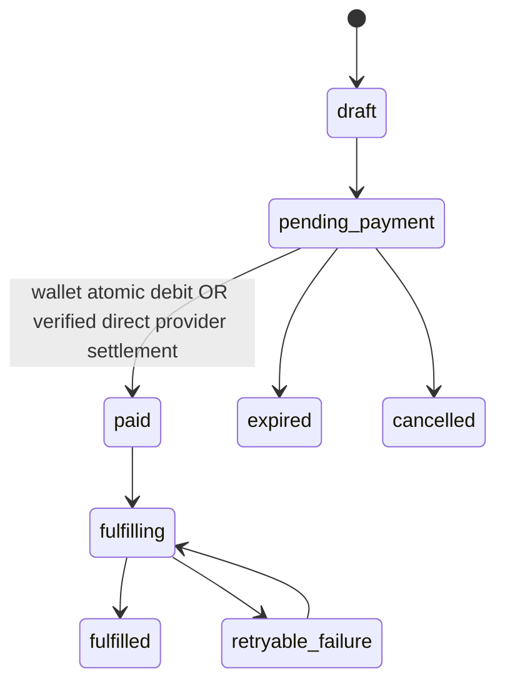
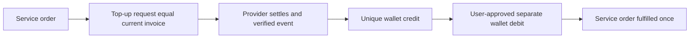

# Payment & Kantong — State Machines, Ledger & Recovery

**Status:** detailed P0 design specification, **not executable financial system**. Only PortalHub's own subscriptions, ad packages and promotion payments use gateway. **Rent/IPL/event/seller-buyer funds never flow through this service.**

## Operational finance vs platform payments

| Payment type | PortalHub platform processing | Evidence |
|---|---|---|
| IPL / rent / event | **No**; internal manual record for external cash/transfer | Private R2 proof, internal verification only |
| SaaS subscription/ad package | **Yes**, settled direct provider checkout or Kantong | Immutable service order and provider evidence |
| Kantong top-up | **Yes**, only after verified provider settled | Provider journal; one wallet credit |
| Kantong service purchase | Internal closed-loop debit | Immutable wallet ledger, service order |

## Canonical state machines (proposed)

`topup`: `created → pending_provider → settled → credited` or `expired/failed`. Do not credit on `created` or browser success.

`provider_payment`: `created → pending → settled` or `failed/expired`; unexpected late settled event after expiry routes to **manual reconciliation**, not automatic entitlement without policy.

`wallet_ledger` is immutable event entries `credit/debit/compensating`; `wallets.cached_balance` is a reconciled projection, not independent money. Every journal has unique origin/idempotency.

## Direct QRIS / transfer

1. Server creates order with immutable product/amount/version and unique idempotency key; provider session/reference is bound to order and billing account.
2. Callback endpoint verifies provider authenticity/signature, amount, currency, reference and merchant association; never trust browser redirect or unknown event.
3. Persist raw event **safely redacted**, unique `provider_event_id`, canonical state, received timestamp, processing attempt. Replay same event is no-op.
4. Confirm final settlement before marking order `paid`. Process out-of-order events via valid transitions or route to reconciliation, never downgrade settled to pending.
5. Fulfill product entitlement **once** by unique order line/service order identity. If worker fails, maintain durable paid state and retry with bounded backoff.
6. Reconcile local totals vs provider statements; mismatch raises incident/queue, never guessed adjustment.

## Wallet debit transaction

Atomic SQL operation (implementation to be reviewed):

- Authenticate billing actor and permission `hub.wallet.spend`.
- Verify service order `pending_payment`, price snapshot, product and subscription eligibility.
- Lock wallet balance / serialize by wallet; check `available >= amount > 0` and valid currency IDR.
- Insert immutable ledger debit with unique `service_order_id` or idempotency key; update cached balance under same DB transaction.
- Mark order paid/record debit reference in same transaction; schedule fulfillment through durable outbox.
- Commit all steps or none. On retry return original debit/result; no negative balance, no ad-hoc balance mutation.

**Important:** database commit cannot be atomically coupled to external provider/R2. Use durable states, outbox, retry and reconciliation rather than pretending distributed atomicity.

## Exact top-up then wallet

Top-up receipt is different from service purchase. If credit succeeds but debit fails (user revokes, order expires, amount changes), balance stays in Kantong until an authorized purchase or legally reviewed refund process; do not force spend or silently consume another order.

## Auto-renew

- Consent default off; record plan/version/price/funding account, actor, timestamp and policy version.
- Unique renewal identity `subscription_id + period_start + renewal_type`; retry must never create a second debit/order for same term.
- Wallet insufficient: no charge, status `payment_required/past_due`, notice; never fallback to unauthorized direct payment.
- Ad listing auto-renew also requires explicit opt-in; do not auto-convert free ads into paid.

## Financial failure & correction matrix

| Event | Safe handling |
|---|---|
| Duplicate webhook | Dedupe unique event, no duplicate top-up/fulfillment |
| Webhook conflicting with local state | Quarantine/reconcile; audit |
| Provider unavailable | Keep pending, bounded retry/poll per provider terms |
| Settlement after order expired | Review/reconcile, don't silently activate |
| Double-click purchase | Same idempotency key/order result |
| Concurrent debit | Lock/unique check, one debit |
| Entitlement activation error | Paid persists; retry via outbox |
| Refund/chargeback | Authorized compensation entry, audit and entitlement review |
| Ledger balance mismatch | Freeze affected wallet writes pending investigation |
| Partial tax/fee/provider settlement differences | Reconcile against ordered amount with explicit accounting treatment |

## Records and controls

- `wallet_ledger`: append-only, immutable completed entries, unique transaction origin, amount positive with debit/credit enum, `wallet_id`, billing actor, timestamps, order reference. Never trust a UI-provided final price.
- `payment_webhook_events`: unique provider event ID and provider reference, processing state, retry count, failure reason, trace ID, redacted payload.
- `audit_logs`: actor/source event, prior/new state, reason, request ID; sensitive values sanitized.
- Separation of duties for manual refunds/adjustments, no direct browser writes to payment status/ledger.
- Platform receipt/invoice files, if stored, live in private **Cloudflare R2**, not in ledger; R2 upload not evidence of provider settlement.

## Test matrix

- Duplicates/reordering/replay, request retries, double-click, parallel renewals, crash between settlement and activation, insufficient funds, forged source events, cross-org wallet access, cancellation/expired order, quote mismatch, refunds/compensation, reconciliation mismatch.
- All tests assert **one financial transition, one debit/credit event, one entitlement activation** as applicable.
- Production disabled until legal, tax, provider and accounting review of closed-loop Kantong; do not claim regulatory exemption.

See [Subscription Lifecycle](Subscription-Lifecycle.md), [Kantong](Kantong-and-Payments.md), [Operational Finance](Operational-Finance.md), [ADR-0002](../10-decisions/ADR-0002-wallet.md).
