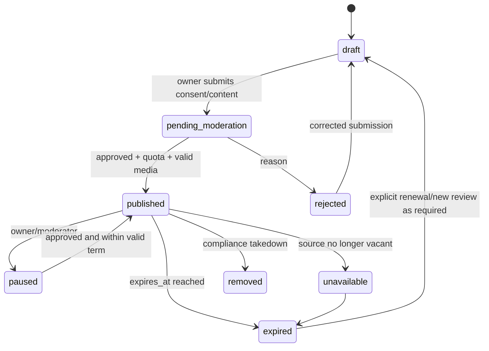

# PortalIklan — Publishing, Moderation & Packages

**Status:** detailed P1 design. PortalIklan is a **public advertising catalog**, not an in-app buyer-to-seller payment, escrow or rental booking service.

## Sources and public data boundary

- Initial listing source: verified PortalKos vacant rental, then opt-in PortalWarga local business; public advertisers added in later phase by product policy.
- An ad creator needs permission for the organization/source record and explicit public consent for contact, neighborhood/area, images and title/description.
- Published projection contains **only approved fields**; it must not join to private `kos_tenants`, `warga_residents`, private addresses, bank proof, leases, or R2 private file keys.
- Property occupancy status is a **source-of-truth** for rental availability; ad text cannot override a source `occupied` state.

## Lifecycle

- `published` requires current source authorization, valid entitlement/quota, consent, moderation decision, valid `expires_at`, and safe public R2 media. Reject direct public creation by bypassing review.
- Moderation decisions record actor, reason, timestamp, version, and appeal/correction path. Changes to sensitive public fields may require re-review.
- `unavailable` and `expired` are **not** equivalent to private data being permanently deleted; public SEO response behavior depends on approved SEO/takedown policy.
- Public listing image is a sanitized **derivative** from R2 public bucket. Draft/under-review raw image remains private/temp. Strip sensitive EXIF/location and do not embed signed private URL in SSR/OG/sitemap.

## Free quota, packages and promotion

- Free ads have `quota_count`, duration, expiry and eligible source policy; exact numbers **TBD**. Every listing has an explicit expiry.
- Package quota / usage uses `package_entitlements` distinct from Kantong monetary balance. Creating/publishing consumes entitlement **atomically and idempotently**.
- Premium/promoted listing is visibly labeled; ranking criteria must be documented, reproducible and not fabricate ratings.
- Free-to-paid conversion requires a *separate explicit purchase*. Auto-renew listing **OFF by default**, requires consent, valid funding and sufficient Kantong; direct QRIS purchase allowed for single renewal.
- No recurring direct payment from previous one-time QRIS unless provider mandate and terms explicitly authorized.

## Source sync and job safety

- PortalKos `available → occupied` sends durable source event/outbox that marks linked listing `unavailable` and removes misleading vacancy search placement. Retry on failure and alert when sync lag exceeds approved threshold.
- Existing listing may link to room *type* instead of individual unit only when aggregate availability is safely computed and no occupied room is falsely advertised.
- Expiry worker compares server UTC to `expires_at`, protected by unique idempotency identity; cannot renew without recorded opt-in/payment/entitlement.
- Deletion/takedown attempts to withdraw public R2 derivative and invalidate CDN cache; external copies may survive and require clear policy.
- Reports/abuse intake need rate limits and moderator review without exposing private user contact unless permitted.

## SEO/public access contract

- SSR returns unique title/description, canonical, human-readable category+city path, structured data that only contains verified fields.
- Sitemap includes only published/indexable URLs; draft/rejected/private pages noindex, no PII in source HTML, JSON-LD or OpenGraph.
- Unavailable/expired pages choose useful public status/canonical/404/410 per explicit lifecycle rules; don't invent Google SEO guarantees.
- Public contact CTA goes to advertiser-approved WhatsApp/form, **not PortalHub checkout**.

## UAT

| ID | Case | Expected |
|---|---|---|
| ADS-01 | Owner publishes without consent | Denied |
| ADS-02 | Draft image on R2 temp/private | Not accessible through public URL/SSR |
| ADS-03 | Moderator rejects | No publication; reason/audit preserved |
| ADS-04 | Free listing reaches expiry | Ends; no charge |
| ADS-05 | Free quota exhausted | Cannot publish free; explicit paid choice |
| ADS-06 | Auto-renew opted out | No wallet debit |
| ADS-07 | Occupied room with active listing | Mark unavailable, stop misleading public claim |
| ADS-08 | Public listing requests private home coordinates | Only explicitly approved area-level data |
| ADS-09 | Duplicate listing publish events | One entitlement consumption/publication |
| ADS-10 | Takedown | CDN/public media invalidated as allowed, audit retained |

**Open decisions:** free quota numbers, ad package prices, listing duration, moderation SLA, ranking/promotion algorithm, takedown/expired URL policy, public advertiser eligibility.

See [PortalIklan SEO](PortalIklan-SEO.md), [Kantong](../05-billing/Kantong-and-Payments.md), [File Storage](../03-data/File-Storage.md), [Notifications & Jobs](../02-architecture/Notifications-and-Jobs.md).
