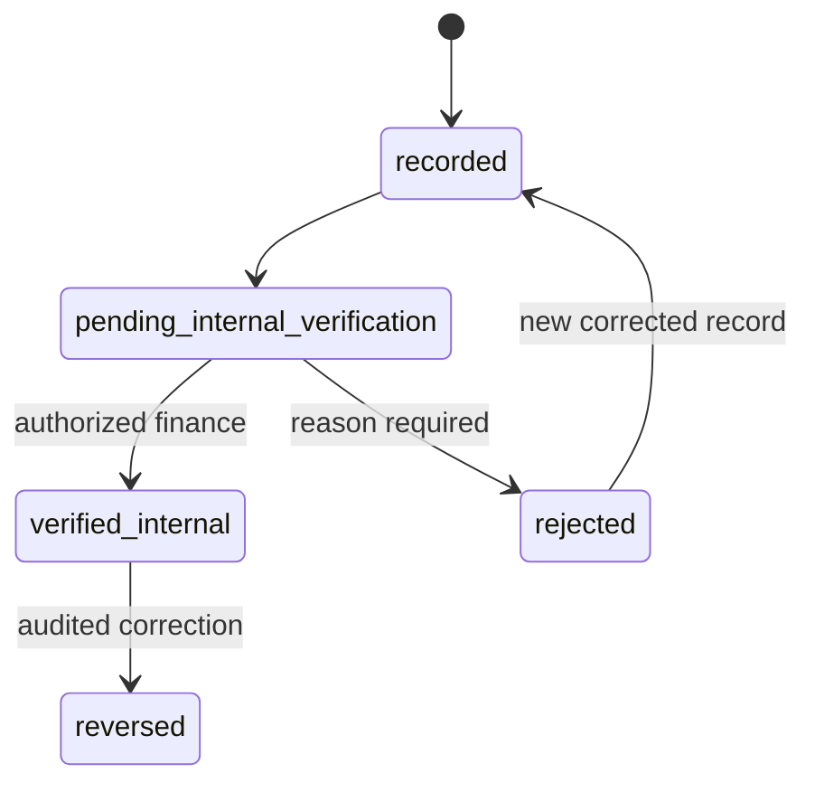

# PortalKos — Business Rules & State Transitions

**Status:** P1 detailed design; rules marked **TBD** require product approval. PortalKos **records** external rent payments only. No PortalHub payment gateway for rent, deposit or tenant-to-landlord transfers.

## Org, property, unit & quota

- One organization owns many `kos_properties`, each has many `kos_units`. Staff permissions are property-scoped; owner sees only orgs and products granted.
- **Subscription unit quota** counts active **rentable units** across all properties in the organization. It does **not** count number of properties or current tenants. Define `rentable` independently from `occupied`; maintenance statuses need explicit catalog policy so quota cannot be gamed. Deactivated/nonrentable units remain historically referenced.
- A unit status should be derived from validated lease/reservation where possible, not manually overriding a lease. Suggested states: `available`, `reserved`, `occupied`, `maintenance`, `inactive`. State transitions logged with actor and timestamp.
- Exceeding quota must block **new entitled units/activations**, not delete existing leases, historical bills or evidence. Treatment during downgrade/trial expiry is **TBD**.

## Tenant, occupant and contract

- A tenant record can exist without a login. Linking a tenant to `auth.users` requires verified invitation/manager approval; email equality alone does not authorize access.
- Lease belongs to one org/property/unit and at least one tenant. Additional occupants must be linked to that lease with appropriate privacy.
- Effective lease period and price snapshots fixed at signing; amendments create versioned change with actor and dates, not silent mutation of settled bills.
- For exclusive unit rental, no two `active` leases with overlapping occupancy dates. Block with database exclusion/lock plus API validation. A shared-bed/room model needs explicit separate business decision.
- Suggested contract states `draft → pending_review → active → ending → ended` or `cancelled` before activation. These are proposals; actual statuses must be fixed before SQL migration.
- Move-out, renewal, transfer to new unit, deposit return and contract termination need separate audited workflow. Rules for notice period and early termination **TBD**.

## Billing schedule

- Suggested charge identity: `organization_id + lease_id + billing_period + charge_type`, unique under retry.
- Amount derives from accepted lease price version and explicit charge rules. **Do not invent** proration formula, late fee %, tax, rent anniversary period, payment due date or grace days. Make them versioned, configurable and testable once approved.
- Generated charge is immutable after verification/settlement history; corrections through adjustment/reversal/new charge with references.
- Monthly billing jobs must be idempotent across worker retries and timezone boundaries; store UTC timestamps and display local dates using configured organization timezone.
- Partial payment may be supported if policy explicitly enables it; allocate to correct charge, track remaining outstanding, never over-apply without defined overpayment/refund policy.

## Payment records (manual only)

- Payment `cash` or `bank_transfer` happens **outside PortalHub**, directed to landlord's own account (not Kantong).
- Upload proof to **private Cloudflare R2** via scoped API; `ready` file scan status does **not** mean bank settlement or finance approval.
- Recorder and verifier are separate actors by default for high-risk actions; any exception policy needs explicit approval. Audit method, amount, period, proof reference, actor, internal status and reason.
- Duplicate receipt/payment reference detection should flag for human review, **not automatically claim external bank settlement**.
- Deposits are liabilities recorded for landlord; not PortalHub balance and not payable via Kantong.

## Expenses, maintenance and reports

- Maintenance ticket has unit/property, priority, assigned staff and status `open/in_progress/resolved/closed` (proposed); attachments R2 private unless published by consent.
- Reports: occupancy, upcoming/expired leases, generated vs paid vs outstanding rent, manual cash/transfer, expenses by property and consolidated org. Exclude reversals or show them explicitly so totals are reconcilable.
- Data export follows permission scope and retention rules, never bypasses tenant boundaries.

## Integration with PortalIklan

- Owner explicitly selects rentable vacant unit and **which fields/images** may be public. Create draft listing → moderation → published projection. Private address and tenant details never copied to public.
- `occupied`, `maintenance` or `inactive` status invalidates an active availability claim; durable outbox updates ad availability and retries after transient failures.
- Listing expires by its own schedule and ad entitlement; public checkout of rental is **out of scope**.

## Edge-case acceptance tests

| ID | Case | Expected |
|---|---|---|
| KOS-01 | 3 properties with 15,20,10 active rentable units | Subscription usage = 45 |
| KOS-02 | Same exclusive unit overlapping active leases | DB/API reject |
| KOS-03 | Tenant A requests tenant B charge/proof | Denied |
| KOS-04 | Staff property A edits property B record | Denied |
| KOS-05 | Two schedulers generate same monthly charge | One charge |
| KOS-06 | Proof ready, finance has not approved | Payment still pending internal verification |
| KOS-07 | Recorded rent reversed | Compensating audit, corrected report, original history preserved |
| KOS-08 | Unit occupied after ad published | Listing marked unavailable without leaking contract details |
| KOS-09 | Plan downgrade below currently registered units | No deletion; controlled over-quota policy applied after decision |

**Unresolved:** prorata, due dates, fees, deposit returns, overpayment, grace periods, quota treatment during maintenance. These are decisions to record in [Decisions](../00-product/Decisions.md), not silently coded.

Related: [PortalKos](PortalKos.md), [Subscription Lifecycle](../05-billing/Subscription-Lifecycle.md), [Permission Matrix](../04-security/Permission-Matrix.md), [Ads Publishing](PortalIklan-Publishing-Rules.md).
