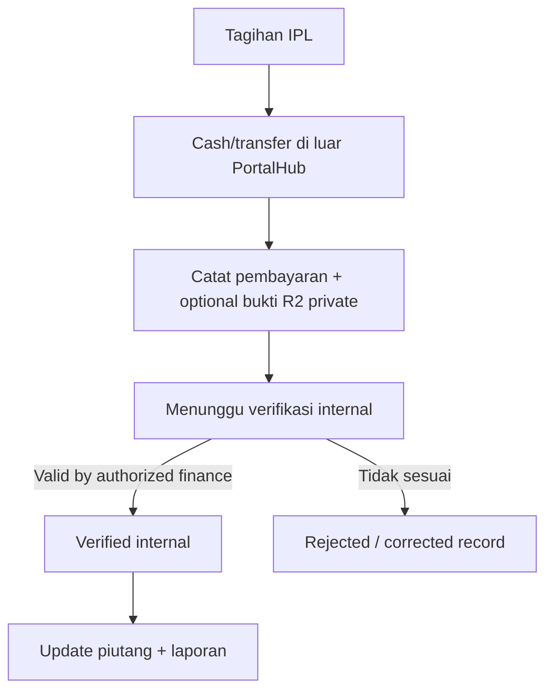

# PortalWarga — IPL, Kas Umum & Keuangan Event

**Status:** detailed P1 design. **IPL dan dana event hanya dicatat** setelah pembayaran eksternal tunai/transfer; PortalHub tidak menyelesaikan transaksi bank tersebut. Historical legacy QRIS IPL bukan integrasi yang diotorisasi pada PortalHub.

## Identitas rumah dan hak warga

- `warga_houses` merupakan unit tagihan rumah; `warga_residents` menyimpan orang, `warga_house_memberships` menyimpan hubungan rumah/penghuni dan verification status.
- Satu rumah dapat memiliki beberapa penghuni/peran pembayaran; penentuan penanggung jawab IPL perlu kebijakan org, bukan otomatis semua penghuni.
- Akun login Google tidak otomatis membuktikan relasi ke rumah; halaman self membatasi data ke hubungan yang telah diverifikasi.
- Koordinator blok hanya melihat scope blok, bendahara sesuai assignment; panitia event tidak otomatis mendapat akses kas umum.

## Tagihan IPL

- Generate tagihan per `house + period + charge_type + policy_version`; cegah duplikat melalui unique identity/idempotency.
- Tarif/rate, keterlambatan, pindah rumah, rumah kosong, perubahan kelas rumah dan penagihan sebagian adalah aturan organisasi **yang belum final**. Simpan versi tarif dan tanggal efektif untuk audit.
- Tunggakan = nilai tagihan sah − alokasi pembayaran terverifikasi internal ± adjustment/reversal sah. Jangan masukkan transfer internal event sebagai pembayaran IPL.
- Due date, pengingat, diskon, denda dan perlakuan pembayaran lebih wajib kebijakan yang disetujui sebelum diaktifkan.
- Setiap koreksi tagihan/bayaran memiliki alasan, actor, timestamp, referensi record asal; tidak dihapus diam-diam.

## Pembayaran IPL manual

`verified_internal` berarti bendahara/petugas berwenang menyatakan sudah diterima; **bukan** klaim bank/provider atau gateway PortalHub. Bukti R2 `ready` status scanner terpisah dari internal finance verification.

## Buku kas umum dan event

- **Kas umum** dan **kas event** merupakan `warga_financial_accounts` terpisah. Event memiliki anggota dan role tersendiri dengan assignment event ID.
- `event_treasurer` hanya baca/tulis keuangan event yang ditugaskan. Org owner maupun ketua event **tidak otomatis** memiliki kewenangan bendahara event.
- Catat pemasukan, pengeluaran, budget dan lampiran berdasarkan satu account/event; expense tidak boleh dibuat pada account event berbeda.
- Pindah kas umum → kas event: satu `warga_internal_transfers` dengan dua posting terikat: debit account umum, kredit account event, nominal sama, transaction/transfer ID sama. **Keduanya atomik**; jangan ada mutasi separuh.
- Laporan masing-masing account menampilkan movement transfer internal terpisah dari `revenue`/`expense`. Laporan konsolidasi **mengecualikan kedua sisi transfer** dari pendapatan/beban, meskipun perubahan kas antar-account tetap tampak.
- Transfer balik dari kas event ke kas umum mengikuti invariants serupa. Hak transfer memerlukan pemeriksaan **kedua** account.
- Closing/lock reporting period, opening balance, koreksi setelah tutup buku dan approval threshold masih memerlukan keputusan operasional.

## Rekonsiliasi dan audit

- Laporan wajib dapat ditelusuri ke bill/payment/financial_transaction/event/transfer dan file bukti.
- Hindari menghitung pembayaran IPL dua kali sebagai `payment_record` dan kas umum external revenue bila keduanya merepresentasikan uang yang sama: gunakan referensi sumber yang unik dan definisi laporan kas vs piutang.
- Reversals/adjustments diakui pada periode dan kategori kebijakan yang disetujui; jangan menulis ulang laporan historis tanpa audit.
- Export laporan mengikuti RBAC dan tidak berisi dokumen privat/R2 URLs publik.

## Tests

| ID | Scenario | Expected |
|---|---|---|
| WRG-01 | Two jobs generate same house period bill | One canonical bill |
| WRG-02 | Warga A sees rumah B IPL / file | Denied |
| WRG-03 | Event treasurer A views event B/general cashbook | Denied |
| WRG-04 | Org owner without event-finance assignment views event B finance | Denied |
| WRG-05 | Transfer 100 from general to event | -100 and +100 linked, consolidated revenue/expense impact 0 |
| WRG-06 | Transfer fails after first attempted insert | Transaction rolls back both sides |
| WRG-07 | Same IPL payment imported twice | No duplicated allocation/revenue |
| WRG-08 | Proof upload passes scan only | Payment remains pending until authorized finance verification |
| WRG-09 | Historical QRIS IPL from legacy | Preserved as historical source, not new platform gateway |

**Pending decisions:** per-house IPL tariff version, due/late/discount rules, closing policy, correction window, transfer approval, RLS role policy for primary/general cashbook. See [Legacy Migration](../02-architecture/Legacy-Migration.md), [Operational Finance](../05-billing/Operational-Finance.md), [RBAC](../04-security/RBAC.md).
