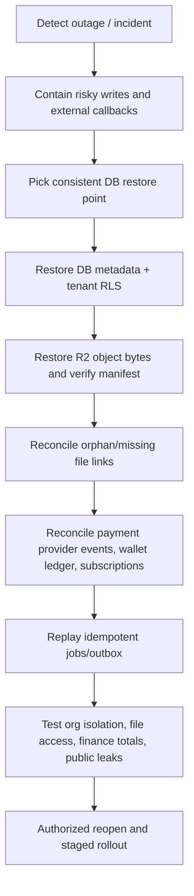

# Disaster Recovery — Supabase, Cloudflare R2 & Application

**Status:** recovery blueprint P1, **not an executed plan**. RPO/RTO, backup schedule and operational owners must be approved before production. No credentials are documented here.

## Recovery objectives (TBD)

| Service/data | Recovery priority | RPO/RTO status |
|---|---|---|
| Supabase auth + membership + RLS metadata | Critical | Not yet approved |
| Billing/Kantong immutable ledger & provider events | Critical | Must reconcile with provider records |
| Operational finance Warga/Kos | High | Historical consistency required |
| R2 private payment/contract documents | High | Restore with correct DB metadata |
| R2 public approved media | Medium | Reconstructable from validated originals if retained |
| PortalIklan SSR & public pages | Medium | Restore approved projection / indexes |
| Search, analytics & thumbnails | Lower | Rebuildable; no authority over financial truth |

Do not invent exact RPO/RTO minutes/hours or promise production SLAs.

## Backup model

1. Back up **Supabase PostgreSQL** with transaction-consistent snapshot/PITR capability as supported by chosen plan; retention policy approved separately.
2. Back up **Cloudflare R2 object bytes** independently with object manifest, bucket/key, size, checksum, classification/version and policy; backup database alone does not recover documents.
3. Store necessary deployment/app configurations and migration history using version control and controlled secure operations; **do not place credential values in documentation**.
4. Keep backups isolated from same outage/blast radius where feasible; enforce retention, least privilege and integrity checking.
5. Account for outbox, pending provider webhooks, in-flight R2 uploads and CDN invalidation jobs. These are not transactionally captured together.
6. Legal hold, personal-data erasure and public takedown policy need corresponding recovery/backup handling.

## Recovery sequence

- On active financial inconsistency, freeze affected debit/fulfillment writes; preserve provider statements and traceable audit evidence.
- Before public re-enablement, validate RLS and scope; avoid restoring stale role grants or deleted public media without review.
- Reconciliation distinguishes provider-settled SaaS payment vs internally verified cash/transfer IPL/sewa.
- Recover private file metadata and bytes together; checksum mismatch remains quarantined for investigation.
- Restore of public R2/CDN must honor consent withdraw/takedown. Rebuild URLs with versioned keys and cache review.

## Drill checklist

| Drill | Expected |
|---|---|
| DB-only restore | Missing R2 bytes reported as gap, not silently claimed recovered |
| R2 bucket corruption/loss simulation | Restore from backup, reconcile checksum + file_links |
| Auth/role revocation during recovery | Recheck current authorization, no cross-tenant access |
| Duplicate provider webhook replay | One wallet credit/debit/entitlement posting |
| Failed outbox job replay | Idempotent one-time domain side effects |
| Public listing takedown | No re-publication of revoked media |
| Full staging restore from synthetic data | Financial totals + attachment references match baseline |
| R2 and DB restore point mismatch | Detection and explicit recovery plan / manual reconciliation |

## Incident communication and evidence

- Incident commander, on-call, escalation contacts and response thresholds are operational decisions to assign before launch.
- Preserve request IDs, sanitized audit trails and provider event references; never paste raw PII, private signed URLs or confidential attachment content into incident notes.
- Capture start/end, systems affected, tenants potentially exposed, containment, recovery verification, decisions and postmortem.
- Notification obligations are determined by approved legal/security policy, not guessed by this document.

See [DevOps Runbook](DevOps-Runbook.md), [Data Retention & Privacy](../03-data/Data-Retention-and-Privacy.md), [Payment State Machines](../05-billing/Payment-and-Wallet-State-Machines.md), [File Storage](../03-data/File-Storage.md).
