# Agent Execution Backlog — PortalHub

> **Status: proposed planning decomposition** dari [Roadmap](Roadmap.md), bukan roadmap alternatif. Tidak ada klaim tiket di bawah telah dikerjakan, dan belum seluruhnya berubah menjadi GitHub Issues. Semua pekerjaan hanya boleh masuk `ready` setelah DoR [Agent Task Contract](../11-agent-operations/AGENT-TASK-CONTRACT.md).

## Dependency DAG — urutan kritis

```mermaid
flowchart LR
  ADR[ARCH-001 ADR-0001 decision] --> HUB001[HUB-001 Workspace+CI]
  HUB001 --> API001[API-001 Contract tooling]
  HUB001 --> DB001[DB-001 Schema & RLS harness]
  DB001 --> SEC001[SEC-001 Tenant RLS]
  SEC001 --> SEC002[SEC-002 Auth+context]
  SEC002 --> HUB002[HUB-002 Org/membership]
  HUB002 --> HUB003[HUB-003 Policy+invite]
  API001 --> BILL001[BILL-001 Service orders mock]
  HUB002 --> BILL001
  BILL001 --> BILL002[BILL-002 Provider mock]
  BILL001 --> BILL003[BILL-003 Wallet ledger mock]
  DB001 --> STO002[STO-002 File metadata+RLS]
  STO002 --> STO003[STO-003 Storage adapter mock]
  HUB002 --> KOS001[KOS-001 Property/units]
  KOS001 --> KOS002[KOS-002 Leases+manual finance]
  KOS002 --> ADS001[ADS-001 Published projection]
  ADS001 --> ADS002[ADS-002 SSR+moderation]
  ADS002 --> SYNC001[SYNC-001 Kos-to-Ads]
  SYNC001 --> LEGACY001[LEGACY-001 Warga mapping]
  LEGACY001 --> WARGA002[WARGA-002 Warga/event finance]
  WARGA002 --> WADS001[WADS-001 Warga-to-Ads]
```

DAG ini menggambarkan **kontrak minimum**, bukan menuntut semua pekerjaan lintas fase dijalankan serial. Lead dapat paralelkan spike UI, fixture, test harness dan analisis legacy lebih awal selama milestone/release tidak dilompati.

## Tiket bootstrap siap dipersiapkan

| Ticket | Phase | Depends on | Owner lane | Deliverable minimum / acceptance | Risk |
|---|---|---|---|---|---|
| ARCH-001 | 0 | Docs existing | Lead/Architecture | Bandingkan 2 app vs 1 app; ratifikasi ADR-0001 sebelum mengunci stack | B |
| HUB-001 | 0 | ARCH-001 | Tooling | Workspace, pinned lockfile, lint/typecheck/test/build, initial Actions CI; no secrets | B |
| API-001 | 0 | ARCH-001 | Contracts | Validate OpenAPI 3.1, generate types, shared schema/error semantics, contract tests | B |
| DB-001 | 0 | HUB-001 | DB | Numbered migrations + synthetic seed, FK scope, RLS harness dan rollback test | B |
| SEC-001 | 0 | DB-001 | Security/DB | Deny-by-default SQL RLS; cross-org/property/event tests | B |
| SEC-002 | 0 | HUB-001, SEC-001 | Identity | Google OAuth callback contract (mock locally), sessions, 0/1/multi-context tests | B |
| QA-001 | 0 onward | HUB-001 | QA | CI evidence, contract/link check, negative tests, traceability reviewer | A |
| STO-002 | 0 | DB-001 | Storage/DB | file_assets/file_links/intents, RLS, reservation quotas; private-by-default | B |
| STO-003 | 0 | STO-002 | Storage | Mock StorageService, signed URL authorization tests, scan/quarantine states | B |
| HUB-002 | 1 | SEC-001/002 | Core | Org/member/selector; disable membership, scope and stale cache tests | B |
| HUB-003 | 1 | HUB-002 | Core | Policy versions, approval, invitations, no retroactive permission | B |
| BILL-001 | 1 | DB-001, API-001, HUB-002 | Billing | Service orders, server pricing interfaces, entitlement projection; mock-only | B/C |
| BILL-002 | 1 | BILL-001 | Billing | Payment provider adapter MOCK, signature + replay, no live settlement | B/D |
| BILL-003 | 1 | BILL-001 | Billing | Immutable ledger, atomic/debit test, no real Kantong | B/D |
| KOS-001 | 2 | HUB-002, DB-001 | Kos | Property/unit schema, aggregated quota with test policy fixture | B/C |
| KOS-002 | 2 | KOS-001 | Kos | Lease overlap, charges/manual payment verify and report; fee policy TBD off | B/C |
| ADS-001 | 3 | KOS-001, API-001 | Ads | Approved public projection no private columns + negative privacy tests | B |
| ADS-002 | 3 | ADS-001 | Ads | SSR SEO, moderation/expiry, approval/quotas configurable; publish flag off while TBD | B/C |
| SYNC-001 | 4 | KOS-002, ADS-002 | Integration | Opt-in listing, occupancy/takedown idempotency tests | B |
| LEGACY-001 | 5 | SEC-001, Phase 4 release gate | Warga migration | Read-only inventory, reversible mapping, diff report; no live cutover | B/D |
| WARGA-002 | 5 | LEGACY-001 | Warga | IPL record-only, general/event cash split, double-count prevention tests | B/C |
| WADS-001 | 6 | WARGA-002, ADS-002 | Integration | Verified proprietor opt-in + Warga ads, SSR privacy tests | B/C |
| MON-001 | 7 | Phase 6 release gate, DEC-PRICE/PAY | Billing/product | Paid plans/promoted listings only after approvals | C/D |

## Shared-file ownership & parallel boundaries

- **Lead** owns `docs/09-delivery/Requirements-Traceability.md`, `docs/00-product/Decisions.md`, `docs/08-operations/OpenAPI.yaml`, root configs/lockfiles merge window.
- **DB lead** owns numbering of `supabase/migrations/`, shared SQL helper grants, and cross-tenant constraints. Never allocate migration numbers independently.
- **Worker** receives exclusive paths and one branch/worktree; submits tests and handoff per [Task Contract](../11-agent-operations/AGENT-TASK-CONTRACT.md).
- **QA/Security** independently tests critical RLS and billing. A blocked production decision cannot be waived by agent consensus.

## Standard ticket ready condition

Every ticket includes: unique ID, phase, requirement ID, owner/reviewer/integrator, dependency PR or mock contract, owned paths, scope/out of scope, risk A–D, acceptance in Given/When/Then, negative tests, and fallback for undecided policy. Use [Agent Task Contract](../11-agent-operations/AGENT-TASK-CONTRACT.md) as issue body.

## Operational note

This table is a **planning source**, not evidence that GitHub Issues, project board, branch protection or automations exist. See [Readiness Checklist](../11-agent-operations/AGENT-READINESS-CHECKLIST.md).
