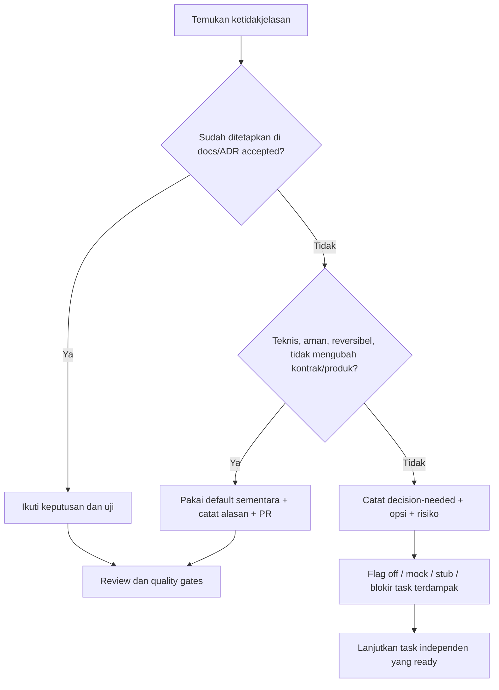

# Autonomous Development Policy — PortalHub

> **Status: DRAFT untuk persetujuan product owner.** Dokumen ini melengkapi, **tidak menggantikan**, [`AGENTS.md`](../../AGENTS.md), [`docs/AI-Agents.md`](../AI-Agents.md), dan roadmap. Dokumen ini **bukan persetujuan** untuk deploy produksi, pemrosesan dana sungguhan, migrasi data nyata, pengeluaran berbayar, atau penggunaan credential.

## 1. Tujuan dan batas kewenangan

PortalHub dapat dikembangkan oleh satu atau banyak AI coding agent dengan interupsi ke product owner seminimal mungkin. Agent diharapkan menyelesaikan keputusan **engineering yang reversibel dan berisiko rendah** secara mandiri; keputusan produk, finansial, legal, privasi dan produksi tetap membutuhkan persetujuan yang sesuai. **Autonomy berarti mampu melanjutkan pekerjaan aman, bukan mengarang spesifikasi.**

Target operasi:

1. Ikuti urutan dan *release gates* yang sudah ditentukan di [`Roadmap.md`](../09-delivery/Roadmap.md) dan [`MVP-and-Release.md`](../01-product/MVP-and-Release.md); jangan membuat roadmap pengganti.
2. Ambil satu tugas dengan requirement ID, dependensi, pemilik, scope file dan acceptance criteria jelas.
3. Gunakan keputusan yang sudah diterima; temukan ketidakjelasan lewat dokumen, bukan lewat asumsi tersembunyi.
4. Jika ketidakjelasan hanya bersifat teknis dan aman, ambil default sementara berdasarkan [`IMPLEMENTATION-DEFAULTS.md`](IMPLEMENTATION-DEFAULTS.md), beri catatan dan tes.
5. Jika ketidakjelasan memerlukan kebijakan/approval, **jangan memblokir seluruh proyek**: tandai tugas/dependensi yang terdampak sebagai `blocked`, lanjutkan tugas independen yang siap dikerjakan.
6. Jangan pernah menyatakan hasil sebagai `implemented`/`tested` tanpa commit, hasil CI, dan bukti penerimaan yang sesuai.

## 2. Urutan sumber kebenaran dan penanganan konflik

Untuk **kewenangan**, guardrail wajib (keamanan, batas pembayaran, larangan kebocoran data, dan hukum/approval produksi) selalu berlaku. Untuk **spesifikasi**, baca dokumen yang relevan, termasuk:

- [`Decisions.md`](../00-product/Decisions.md) dan ADR yang **accepted** untuk keputusan yang sudah disahkan; ADR `proposed` tidak setara dengan keputusan yang diterima.
- [`PRD.md`](../PRD.md) untuk kebutuhan dan *business invariants*; [`Roadmap.md`](../09-delivery/Roadmap.md) serta [`MVP-and-Release.md`](../01-product/MVP-and-Release.md) untuk urutan dan batas rilis.
- [`Architecture.md`](../Architecture.md), [`Database-Schema.md`](../03-data/Database-Schema.md), [`Permission-Matrix.md`](../04-security/Permission-Matrix.md), [`RLS-Policy-Spec.md`](../04-security/RLS-Policy-Spec.md) serta dokumen domain untuk desain terperinci.
- [`AI-Agents.md`](../AI-Agents.md), [`Test-Plan.md`](../09-delivery/Test-Plan.md) dan [`Requirements-Traceability.md`](../09-delivery/Requirements-Traceability.md) untuk proses, tes dan bukti.

Jika dua sumber **yang sama-sama disahkan** bertentangan, **jangan diam-diam memilih salah satu**. Buat `decision-needed` dengan referensi kedua dokumen, dampak, opsi dan rekomendasi; gunakan batas yang lebih aman sementara dan blokir hanya implementasi yang bergantung pada konflik itu. Keputusan produk tidak boleh diubah hanya melalui dokumen default teknis.

## 3. Matriks otonomi keputusan

| Kelas | Contoh | Agent boleh | Perlu persetujuan |
|---|---|---|---|
| **A — Mandiri** | Refaktor internal terbatas, penamaan variabel, unit test, dokumentasi inline, pilihan utilitas tanpa kontrak eksternal | Implementasikan dengan tes, review dan PR | Tidak perlu bertanya selama memenuhi kontrak |
| **B — Mandiri bersyarat** | Versi dependency, lint/test tooling, internal component pattern, mekanisme mock, indeks DB yang aman, UX minor yang tidak mengubah alur/izin | Buat proposal ringan atau ADR jika konsekuensi lintas modul, pilih default aman, uji dan buat PR | Review oleh integrator/maintainer; owner bila berubah menjadi keputusan produk |
| **C — Memerlukan keputusan produk** | Harga, masa trial/kuota numerik, tarif IPL, prorata/denda kos, aturan refund, downgrade/over-quota, batas akses baru, teks syarat layanan | Spesifikasi antarmuka dan konfigurasi tanpa nilai produksi; mock atau feature flag `off` | Product owner/penanggung jawab domain |
| **D — Memerlukan validasi spesialis & approval rilis** | Kantong dan dana prabayar, provider settlement, perpajakan, privasi/retensi hukum, transfer data pribadi, deploy produksi, migrasi data live, akses secret, biaya eksternal | Prototipe dengan data sintetis/mock dan tes; dokumentasikan blocker | Product owner + pihak berwenang yang relevan |

**Aturan eskalasi:** ketika ragu apakah tindakan mengubah uang, hak akses, histori finansial, data pribadi, kontrak publik, atau produksi, **naikkan ke kelas C/D**. Tidak ada kebijakan “auto-approve karena tidak ada jawaban”.

## 4. Keputusan operasional tanpa menanyakan detail berulang

Gunakan langkah berikut setiap kali ada pertanyaan yang belum terselesaikan:



Sebuah pertanyaan tidak perlu dikirim ke product owner jika jawabannya ada di dokumen, atau jika pilihan teknis bersifat terbatas, dapat dibalik, tidak memproses uang riil, tidak melemahkan kontrol keamanan dan tidak memaksakan kebijakan bisnis. Bila perlu keputusan manusia, konsolidasikan dalam **satu daftar keputusan berkala**, bukan banyak pertanyaan tanpa konteks.

## 5. Guardrail yang tidak boleh didelegasikan/dilewati

- **Tenant isolation:** `organization_id`, membership aktif, product entitlement, role, permission dan *resource scope* diverifikasi API serta PostgreSQL RLS. Deny by default. Owner organisasi **bukan** otomatis bendahara event.
- **Batas pembayaran:** IPL, sewa, deposit dan kas event adalah pencatatan tunai/transfer eksternal. Gateway, Kantong, QRIS dan top-up **hanya untuk layanan PortalHub** yang diizinkan. Jangan memakai alur QRIS IPL dari legacy sebagai checkout PortalHub.
- **Kantong:** closed-loop service credit; saldo tidak negatif; ledger immutable; transaksi idempotent; provider-settled untuk top-up/direct payment; auto-renew opt-in; pembayaran produksi menunggu legal/provider/accounting review.
- **File:** semua file baru memakai Cloudflare R2 sesuai ADR-0003. Private/temp tidak publik, akses melalui API terotorisasi, scan/quarantine dan signed URL TTL pendek; tidak mengasumsikan Supabase RLS melindungi object R2.
- **Public ads:** hanya publish fields yang disetujui pemilik dan moderator; data rumah, penyewa, kontrak, bukti transfer, dan kunci objek privat tidak boleh bocor ke SSR, sitemap atau analytics.
- **Privasi & histori:** data sintetis di development/CI; tidak menghapus histori akuntansi tanpa jurnal koreksi; tidak mengubah grant/aturan onboarding secara retroaktif tanpa approval.
- **Infrastruktur:** tidak membuat secret, meminta nilai credential dalam dokumen/PR/log, mengaktifkan provider live, mengubah billing berbayar, deploy produksi, atau mengubah repo legacy `PortalWarga` tanpa otorisasi khusus.

## 6. Perilaku ketika keputusan belum tersedia

Gunakan **fail-closed**, bukan nilai bisnis buatan:

- Harga/kuota/trial/expiry/denda/prorata belum disetujui → buat schema konfigurasi dan validasi; gunakan *test fixtures* bernama jelas hanya di test/preview; **nonaktifkan checkout/publikasi yang bergantung pada harga/kuota valid**.
- Payment provider atau kebijakan Kantong belum disahkan → implementasikan interface, mock provider, state machine dan idempotency tests; jangan menjalankan transaksi riil.
- Policy verifikasi PortalWarga belum final → pending approval dan tidak memberi kewenangan sensitif otomatis.
- Privasi/retensi belum final → simpan metadata klasifikasi dan legal-hold support, jangan menerapkan hapus otomatis tanpa kebijakan.
- Arsitektur dengan status `proposed` → lakukan spike kecil/ADR review sebelum mengunci pilihan yang sulit dibalik.

## 7. Laporan keputusan tanpa membebani product owner

Untuk setiap isu C/D, buat catatan (misalnya issue GitHub dengan label `decision-needed`) dalam format:

```text
ID / area:
Referensi requirement + dokumen:
Keputusan yang belum ada:
Opsi A/B (+ tradeoff singkat):
Rekomendasi agent (bukan keputusan):
Dampak jika ditunda:
Safe fallback yang diterapkan:
Tugas yang terblokir / tugas lain yang bisa lanjut:
Pihak yang harus menyetujui:
```

Kumpulkan isu sejenis dalam satu review batch. **Tidak ada batas waktu yang menyebabkan persetujuan otomatis.** Setelah keputusan disahkan, perbarui register keputusan/ADR, dokumen domain, konfigurasi, acceptance test, dan traceability.

## 8. Selesai berarti terverifikasi, bukan “agent mengatakan selesai”

Tugas baru boleh dinyatakan selesai bila memenuhi [`AGENT-TASK-CONTRACT.md`](AGENT-TASK-CONTRACT.md): PR yang bisa direview, pemeriksaan relevan lulus, evidence terhadap acceptance criteria, tidak ada kebocoran lintas tenant, migrasi/rollback terdokumentasi, serta traceability diperbarui sesuai mekanisme integrasi. Label `blocked` atau `partial` wajib digunakan bila feature flag tetap off atau persetujuan belum didapat.

**Catatan adopsi:** kebijakan ini baru berlaku sesudah disetujui dan dihubungkan dari `AGENTS.md` serta indeks dokumentasi. Draft belum mengubah kewenangan apa pun.