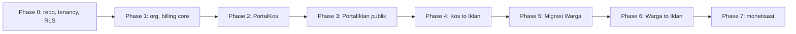

# Multi-Agent Collaboration Protocol — PortalHub

> **Status: DRAFT.** Ini adalah protokol kolaborasi untuk agent yang bekerja pada **roadmap yang sudah disahkan**, bukan roadmap baru. Wajib dibaca bersama [`AGENTS.md`](../../AGENTS.md), [`AI-Agents.md`](../AI-Agents.md), [`Roadmap.md`](../09-delivery/Roadmap.md), dan [`AUTONOMOUS-DEVELOPMENT.md`](AUTONOMOUS-DEVELOPMENT.md). Konfigurasi alat orkestrasi/izin GitHub nyata harus ditetapkan oleh operator; keberadaan dokumen ini **tidak** berarti orkestrator otomatis sudah berjalan.

## 1. Model organisasi kerja

**Lead / Integrator** adalah satu pemegang tanggung jawab koordinasi: memecah roadmap resmi menjadi task independen, menyatakan task `ready`, mengalokasikan kepemilikan, mengurutkan perubahan bersama, mereview hasil, mengatur merge dan menjaga kualitas main branch.

| Peran agent | Tanggung jawab | Kewenangan dan batasan |
|---|---|---|
| **Lead / Integrator** | Dependency graph, assignment, shared contracts, review PR, merge queue, traceability | Tidak boleh mem-bypass release gate atau mengesahkan kebijakan bisnis C/D |
| **Identity / Core** | Auth, org, membership, invitations, product context, RBAC | Tidak boleh memberi akses implisit lintas domain |
| **Data / RLS** | Migration, FK komposit, SQL RLS, scoped test fixtures | Pemilik eksklusif perubahan schema bersama selama integrasi |
| **Backend / API** | Service boundaries, OpenAPI, validation, outbox | Tidak membuat endpoint produksi tanpa otorisasi |
| **Frontend / UX** | Shared UI, private PWA, public Ads SSR berdasarkan fase | Tidak menjadikan UI hiding pengganti authorization |
| **Product Domain** | Kos, Iklan, Warga sesuai fase roadmap | Jangan mengubah repo `PortalWarga` legacy tanpa izin terpisah |
| **Billing / Storage** | Service order, Kantong mocks, R2 adapter, upload lifecycle | Tidak memproses dana riil; R2 private by default |
| **QA / Security** | Negative tests, contract tests, E2E, audit dan review independen | Dapat memblokir merge bila temuan kritis; tidak menghapus bukti kegagalan |

Agent dapat merangkap peran bila tim kecil. **Satu task tetap hanya memiliki satu `owner` dan satu `integration_owner`**. QA yang mereview perubahan finansial/RLS sebaiknya bukan agent yang menulis implementasi tersebut.

## 2. Tahap pekerjaan tidak boleh melompati roadmap

Urutan fase **tetap** mengikuti [`Roadmap.md`](../09-delivery/Roadmap.md): fase 0 (fondasi) → 1 (org/billing) → 2 (Kos) → 3 (Iklan publik) → 4 (Kos→Iklan) → 5 (migrasi Warga) → 6 (Warga→Iklan) → 7 (monetisasi). Ini tidak melarang pekerjaan **desain, kontrak, tes, atau mock** untuk fase berikutnya selama tidak merusak *release gate* dan tidak menyalakan fitur sebelum dependensinya beres.

Sebelum paralelisasi, Lead membangun **dependency DAG** dari ticket roadmap:



Diagram fase bersifat **urutan milestone**, bukan berarti seluruh task dalam fase harus serial. Paralelkan pekerjaan yang punya kontrak dan owner file berbeda, misalnya UI shell, test harness, dan desain RLS dalam fase fondasi; integrasikan menurut dependensi yang nyata.

## 3. Kontrak kerja sebelum agent mengambil task

Sebuah task baru dapat berstatus `ready` bila ada:

- Ticket ID yang unik, requirement ID, fase, outcome, acceptance criteria dan test minimum.
- Dependensi PR/schema/contract yang jelas, atau mock interface yang disetujui.
- Daftar file/folder yang **boleh** diubah dan daftar area terlarang.
- Risk class A/B/C/D dari Autonomous Development Policy.
- Owner, reviewer dan integration owner.
- Status keputusan (`accepted`, `proposed`, `TBD`, `blocked`) serta fallback yang aman.

Gunakan format di [`AGENT-TASK-CONTRACT.md`](AGENT-TASK-CONTRACT.md). Jangan mengeluarkan beberapa task yang menulis migration atau file kontrak pusat yang sama secara bersamaan.

## 4. Branch, worktree, dan ownership

- **Satu task = satu branch + satu PR**. Contoh: `agent/p0/HUB-001-bootstrap`, `agent/p0/SEC-001-tenant-rls`. Gunakan branch dari commit `main` terbaru yang disetujui Lead; catat base SHA di tugas.
- Tiap agent bekerja pada worktree/checkout terisolasi; jangan memakai working directory bersama untuk perubahan yang bersaing.
- Tidak ada direct push atau force-push ke `main`. Merge hanya setelah branch protection, review, CI dan release gate relevan.
- Setiap PR kecil dan *single-purpose*. Perubahan lintas modul hanya bila interface/dependensi memerlukannya dan dinyatakan eksplisit.
- **Shared/high-conflict files** (`package.json` root, lockfile, root config, `AGENTS.md`, `docs/Architecture.md`, `docs/09-delivery/Requirements-Traceability.md`, `docs/08-operations/OpenAPI.yaml`, shared types, migration allocation) mendapat owner integrasi tunggal per merge window.
- Perubahan SQL migrations tidak boleh menggunakan nomor yang sama. Lead mengalokasikan nomor/rentang; migration yang sudah masuk `main` tidak diedit ulang, lakukan migration baru.
- Jika kepemilikan bertabrakan, *pause* hanya PR yang berbenturan, selesaikan melalui pemecahan tugas, rebasing, atau urutan merge yang diumumkan.

## 5. Contract-first dan batas domain

1. Perubahan API harus menyepakati OpenAPI/schema dan permission contract lebih dulu. Frontend boleh memakai mock untuk kontrak yang disepakati; tidak boleh mengarang response shape yang lain.
2. Domain mengakses domain lain melalui service/API tepercaya atau event/outbox. UI tidak menulis tabel domain lain secara langsung.
3. Database memakai `organization_id` sebagai nama tenant kanonik; tidak mencampur `org_id` dan `organization_id` sebagai kolom berbeda. Uang IDR `amount_minor bigint` berarti rupiah utuh, bukan sen.
4. Akses data wajib mempertimbangkan org/product/role/resource scope pada API dan RLS. Scope *property*, *event* dan *verified self* tidak bisa disimpulkan dari jabatan saja.
5. Event finansial dan pembayaran memiliki *state machine* serta idempotency; satu tim tidak boleh mengganti status canonical tanpa review seluruh consumer dan tes.
6. R2 `file_assets` metadata dan file bytes adalah dua boundary berbeda; signed URL hanya diterbitkan server sesudah pemeriksaan izin.

## 6. Siklus tugas dan handoff

Gunakan status konsisten:

`backlog → ready → claimed → implementing → pr_open → in_review → approved → merged → verified`

Alternatif: `blocked` (keputusan/dependensi), `changes_requested`, `cancelled`. `verified` hanya setelah bukti tes dan integrasi yang benar; merge tidak otomatis berarti tervalidasi penuh.

**Handoff per PR** harus mencakup:

1. Ringkasan perubahan dan requirement IDs.
2. File, migrations, API/schema, izin/RLS, background jobs atau environment contract yang terdampak.
3. Perintah tes yang dijalankan **beserta hasilnya**, bukan klaim tanpa output.
4. Keputusan teknis baru beserta ADR/link issue atau catatan default sementara.
5. Known risks, blocked follow-up, backward compatibility, rollback plan, serta screenshot untuk UI.
6. Bukti yang akan dicatat ke `Requirements-Traceability.md` (PR/commit/test/UAT). Lead/Integration owner memastikan pembaruan traceability **sebelum merge** ketika requirement berubah; jangan biarkan dua agent mengedit file pusat itu serentak.

## 7. Merge queue dan pengendalian perubahan bersama

Lead memproses PR sesuai DAG, bukan berdasarkan siapa paling cepat selesai:

1. Pastikan task tidak melewati keputusan `blocked` dan tidak menyentuh perubahan yang tidak diotorisasi.
2. Rebase/update ke target integrasi; jalankan tes ulang yang relevan setelah perubahan dependency.
3. Bila ada migration, terapkan *staging/local migration test* dan negative RLS test sebelum merge; jangan menabrak migration lain.
4. Review contract compatibility, privacy, money, outbox/event, PWA cache dan SSR disclosure sesuai area.
5. Merge satu per satu pada titik konflik schema/API/shared package; jangan mengandalkan *green CI* dari branch lama setelah base berubah.
6. Pastikan `Requirements-Traceability.md` dan ADR/docs direkonsiliasi sesuai keputusan terbaru.
7. Tag status `verified` hanya setelah CI dan *acceptance evidence* yang dapat ditelusuri.

**Jangan membuka fitur produksi atau menggabungkan perubahan berisiko hanya karena semua agent menandai task `done`.**

## 8. Pola kegagalan dan penyelesaiannya

| Masalah | Tindakan wajib |
|---|---|
| Dua agent mengubah endpoint/schema yang sama | Tetapkan satu contract owner; PR lain menunggu/rebase terhadap kontrak final |
| Nomor migration bentrok | Jangan rewrite migration yang sudah merged; alokasikan nomor baru & jalankan ulang test |
| UI siap, backend belum | Gunakan mock contract dan label partial; jangan klaim E2E berhasil |
| Dokumen memberi keputusan yang bertentangan | Catat `decision-needed`, gunakan fallback aman, lanjutkan task yang tidak bergantung |
| Payment/ledger bug atau cross-tenant leak | Stop merge/deploy path terdampak, buka issue kritis, simpan bukti sanitized, lakukan review independen |
| CI gagal atau unavailable | Status belum verified; laporkan error; jangan menandai lulus secara manual |
| Agent mati/terputus | Lead mengalihkan task beserta branch, base SHA, state dan handoff; hindari menggandakan aksi finansial/DB |
| Roadmap berubah | Harus ada keputusan terotorisasi serta pembaruan dokumen resmi; tidak cukup hanya chat antar-agent |

## 9. Template koordinasi harian (opsional, tidak mengubah roadmap)

```text
Current roadmap phase:
Ready tasks and dependencies:
Claimed tasks (owner / branch / base SHA / file ownership):
PR queue (reviewer / CI / migration ordering):
Shared contract revisions:
Decision-needed / blocked (who approves, safe fallback):
Risk alerts (security / finance / privacy):
Merged + tested evidence (PR/commit/test):
Next independent work:
```

Jadwal standup atau pilihan sistem orkestrasi tidak dipaksakan oleh dokumen ini. Kalau platform tooling tidak dapat menjamin locking/queue, Lead wajib mengurangi concurrency pada area bersama.

## 10. Kondisi berhenti

Agent harus **menghentikan hanya operasi terdampak** ketika hendak: menyentuh provider pembayaran live, memproses atau memigrasi data pribadi nyata, membuat produk berbayar tanpa terms dan harga sah, mengubah permission sensitif tanpa review, mengakses production credentials atau mempromosikan release tanpa approval. Beri issue dan lanjutkan pekerjaan aman lain yang memenuhi `ready`.