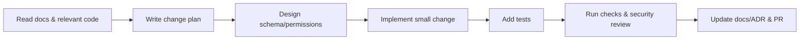

# AI-Agents — Engineering Instructions for AI Coding Agents

> **Scope:** seluruh perubahan kode di repository PortalHub. Dokumentasi ini adalah instruksi kerja pengembang, **bukan izin** untuk melakukan deploy/pembayaran/migrasi otomatis.

## Context wajib dibaca

1. `README.md` dan `AGENTS.md` di root; `docs/PRD.md`, `docs/Design-System.md`, `docs/Architecture.md`.
2. `docs/04-security/Permission-Matrix.md`, `docs/04-security/RLS-Policy-Spec.md`, `docs/05-billing/Payment-and-Wallet-State-Machines.md`, `docs/03-data/Database-Schema.md`.
3. [Indeks dokumentasi](README.md), [Requirements Traceability](09-delivery/Requirements-Traceability.md), ADR terkait dan source/test yang sedang diubah; baca dokumentasi legacy jika menyentuh migrasi PortalWarga.

## Golden rules

1. **Never invent requirements or claim completion.** Jika ambigu, buat decision log/ADR dan pilih implementasi aman yang tidak membuat transaksi finansial.
2. **Tenant isolation first.** Setiap query bisnis organisasi harus memeriksa membership + produk + role + scope. UI hiding bukan security.
3. **No operational payment gateway.** IPL, sewa, event, pembeli/penjual: `cash` atau `transfer` dicatat, bukti opsional, verified internally. Gateway hanya untuk jasa PortalHub.
4. **Wallet is service-only.** Tidak ada transfer wallet-to-wallet, cash withdrawal, atau negative balance. Ledger immutable, top-up settled-only, debit idempotent.
5. **Do not auto-charge without opt-in.** Simpan consent, harga, periode, idempotency key, audit. Gratis tidak otomatis berbayar.
6. **Event finance separate.** Event-scoped roles, cashbook tersendiri, transfer internal berpasangan, konsolidasi no double count.
7. **Do not modify legacy PortalWarga blindly.** Legacy QRIS IPL harus ditinjau dan dilepas dari alur platform baru; event foundation dipertahankan bila cocok.
8. **Private data never in public Ads.** Explicit publication whitelist + consent; alamat detail/kontak hanya sesuai opsi publikasi.
9. **No secret in client, docs, logs, or sample code.** Sanitasi PII, signature verification, dependency audit.
10. **Do not change org policies retroactively** without explicit migration approved and audit log.

## Recommended workflow



Per task: tentukan domain, requirement ID, data exposure, authorization scope, state transitions, edge cases, backwards compatibility, migration/rollback. Buat commit/PR kecil; hindari refactor besar yang tidak diminta.

## Coding conventions

- React components kecil dan accessible; data fetching via shared query layer; business calculations di server.
- Database migrations numbered, additive-first, transactional where possible, rollback plan dan query validation.
- Financial amounts in integer IDR (no floating currency math), timestamps UTC + locale display.
- Idempotency keys unique and scoped, wallet debit with atomic DB operation and immutable ledger.
- Input validation both client and server. Pagination/filters server-side untuk tabel besar.
- Code-generated API types/contracts bila tooling tersedia; jangan duplikasi enum status tanpa central contract.
- Naming jelas: `recorded`, `pending_internal_verification`, `verified_internal` untuk pembayaran operasional; `pending`, `settled` untuk platform payments.

## Required tests by change type

| Changed module | Minimum tests |
|---|---|
| Auth/RBAC | forbidden cross-org, disabled member, no privilege escalation, per-property/per-event scope |
| PortalKos | booking/lease overlaps, availability, unit quota, manual payment verification |
| PortalWarga | IPL matrix totals, general/event separation, internal transfer pairs |
| Ads | unpublished cannot be indexed, expiry, moderation, publish/close sync |
| Billing | duplicate webhook, double click/retry, insufficient balance, refund/reversal, auto-renew once |
| PWA | offline privacy, service worker update, responsive and keyboard access |
| SEO | SSR HTML meta, canonical, sitemap/noindex, deleted listing handling |

## Definition of done per PR

- Requirement ID & acceptance criteria disebut dalam PR.
- Schema + RLS policies included; negative authorization tests pass.
- Build/lint/unit/integration/E2E relevant tests pass and CI output linked.
- No secrets, no private PII exposure, no unaudited finance updates.
- Migration and rollback/backfill steps documented where needed.
- Docs & ADR updated, screenshots for UI changes, observability/error states implemented.
- Any incomplete/untested item marked explicitly; no claim “production-ready” without evidence.

## Agent PR template

```markdown
### Requirement / problem
### Design and affected domains
### Tenant/role/scope checks
### Finance/payment implications
### Schema/migration & rollback
### Tests executed (commands + results)
### Screenshots (desktop/mobile)
### Risks / open questions
```

## Never-do examples

- `select * from tenants` without tenant+scope enforcement.
- Service role key in React client.
- Change `wallet.balance = wallet.balance - amount` from browser or with no ledger lock/transaction.
- Activate subscription based only on browser success redirect.
- Show private residents/tenants info on public ad detail.
- Allow staff assigned only to Kos A to read Kos B via crafted UUID.
- Treat QRIS in legacy PortalWarga as approved for IPL settlement in PortalHub.
## Aturan autentikasi dan izin
- Gunakan Supabase Auth dengan Google OAuth sebagai metode login utama, opsi email OTP/magic link configurable.
- Google OAuth adalah authentication; Supabase PostgreSQL RLS adalah authorization pada data. Jangan menyamakan keduanya.
- User yang sukses login belum tentu menjadi anggota organisasi; cek membership aktif, product entitlement, role, scope dan RLS. Default deny.
- Jangan menaruh service_role di frontend atau melemahkan RLS untuk mengejar kemudahan login.


## Cloudflare R2 storage rules — WAJIB

- Gunakan **Cloudflare R2**, bukan Supabase Storage, untuk file baru PortalHub. Supabase Auth + PostgreSQL RLS untuk login/metadata/izin **tidak** otomatis membatasi objek R2.
- Backend menegakkan org membership, role, product entitlement, entity ownership dan resource scope pada upload intent, download, publish, delete; jangan percaya bucket/key/entity_id dari browser.
- R2 secret hanya pada backend dan berbeda per environment; jangan gunakan `VITE_` atau `NEXT_PUBLIC_` untuk credential. Bucket private/temp tak boleh punya public URL.
- Presigned PUT/GET berumur pendek memakai **R2 S3 API hostname**, bukan custom media domain. Scan MIME asli, size, malware dan checksum (bila dipakai) setelah upload sebelum status `ready`; kuota atomik dan cleanup orphan.
- Media iklan hanya menjadi publik setelah consent + moderasi + sanitasi EXIF; URL file privat jangan masuk HTML publik, sitemap, telemetry atau PWA offline cache.
- Buat storage adapter, metadata `file_assets` + RLS, tests negatif lintas tenant/property/event, backup R2 terpisah dari DB, lifecycle dan audit.
- Baca [File-Storage.md](03-data/File-Storage.md) dan [ADR-0003](10-decisions/ADR-0003-cloudflare-r2.md) sebelum membuat modul dokumen atau media.


## Checklist terbaru: perbaikan audit dan source-of-truth

- Akses keuangan event tidak otomatis untuk owner organisasi: perlu role grant scoped yang eksplisit sesuai [Permission Matrix](04-security/Permission-Matrix.md).
- Spec database terinci ada di [Database Schema](03-data/Database-Schema.md); existing Data-Model.md/ERD.md bersifat konseptual. Jangan anggap pseudocode sebagai migrations siap deploy.
- State subscription dan payment harus mengikuti [Subscription Lifecycle](05-billing/Subscription-Lifecycle.md) serta [Payment State Machines](05-billing/Payment-and-Wallet-State-Machines.md). Wallet purchase tidak menunggu webhook baru setelah saldo settled dan debit atomik berhasil.
- API machine-readable yang tersedia adalah **draft** [OpenAPI.yaml](08-operations/OpenAPI.yaml), bukan janji endpoint berjalan. Tambahkan schema & contract tests saat coding.
- Semua tugas harus mengisi [Requirements Traceability](09-delivery/Requirements-Traceability.md). Jangan mengubah status implemented/tested tanpa bukti commit/CI.
- **Kecualikan setup dan nilai credential** dari dokumentasi ini; jangan meminta/menuliskan secret, token, key atau password.
