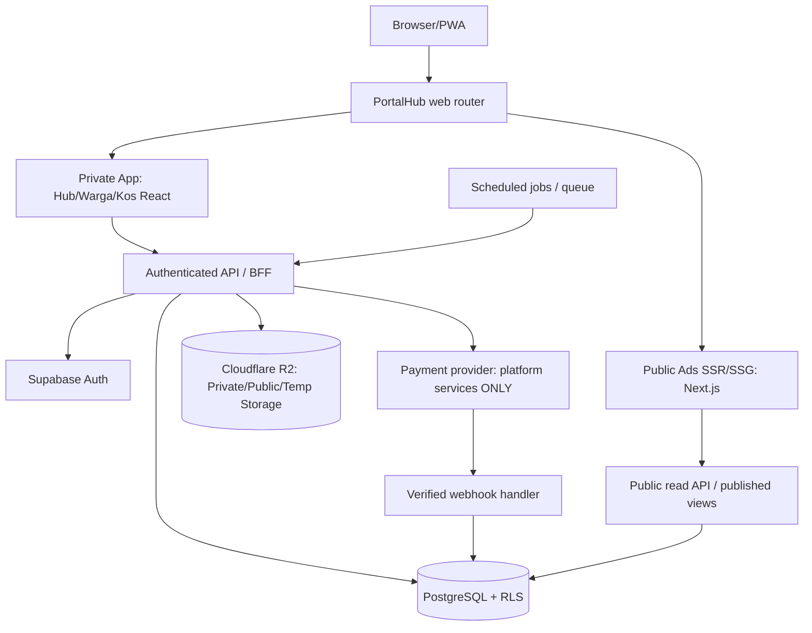
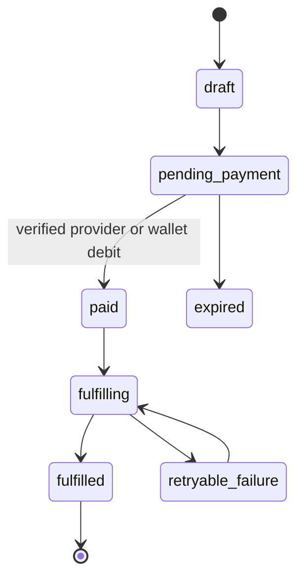

# Architecture — PortalHub

**Status:** Rancangan arsitektur v0.1 · 19 November 2026. Bukan pernyataan infrastruktur sudah tersedia.

## 1. Pilihan arsitektur

**Modular monolith** dengan batas domain jelas, shared auth & PostgreSQL Supabase dan beberapa aplikasi frontend deployable. Hindari microservices sejak awal; gunakan background worker/jadwal untuk pembayaran dan masa iklan.



### Frontend options

- **PortalHub private app**: React + Vite + Tailwind + React Router + TanStack Query (selaras legacy).
- **PortalIklan**: Next.js SSR/SSG/ISR untuk SEO (bisa terpisah deploy dengan rewrite pada domain utama).
- **PWA**: app manifest/service worker untuk private app; halaman iklan publik tetap SSR agar crawler mendapat HTML bermakna.
- Path desain: `/app`, `/warga/:orgSlug`, `/kos/:orgSlug`, `/iklan`, `/iklan/{category}/{city}/{slug}-{id}`. Auth callback mengembalikan user ke relative path tervalidasi.

## 2. Domain boundaries

| Domain | Tanggung jawab |
|---|---|
| Identity & Access | profiles, membership, role, scope, invitations, policies |
| Organization & Product | org/product enrollment, quotas, policy overrides |
| Billing | service orders, invoices, Kantong, direct payment, subscriptions, entitlements |
| PortalKos | properties, units, leases, billing records, operational finance |
| PortalWarga | houses/residents, IPL, general cashbook, events/event finance |
| PortalIklan | listings, moderation, publication, expiry, package consumption |
| Notification & Audit | email/outbox, alerts, security activity |

**Command boundaries:** jangan tulis langsung ke tabel domain lain dari UI; gunakan service/API tepercaya dan transaction boundary yang eksplisit. Public Ads hanya membaca published data projection; tidak query profil private.

## 3. Multi-tenancy & authorization

- Semua tabel berisi data tenant memiliki `organization_id NOT NULL`, indeks `(organization_id, ...)`, FK komposit bila relasi silang tenant.
- PostgreSQL RLS: auth user harus menjadi anggota aktif organisasi; product permission dan scope resource juga diperiksa server-side.
- `organization_id` dari request diverifikasi membership, tidak cukup dipercaya dari parameter URL.
- Never expose Supabase service role key to browser. `SECURITY DEFINER` dengan search_path eksplisit dan execute privileges terbatas; test fungsi sebelum deploy.
- Public listings ditempatkan di tabel/projection publik minimal, tanpa phone/PII privat kecuali opt-in.

## 4. Billing state machines



- `service_orders` adalah satu titik pembelian; sumber dana: wallet debit atau direct payment.
- Webhook memverifikasi signature, amount, merchant reference, provider event ID, state, dan menolak replay; journal append-only, idempotency key unique.
- Top-up hanya menambah saldo setelah settled. Direct payment **tidak** mencatat `wallet_credit`; opsi “top-up tepat tagihan” membuat top-up dan pembelian sebagai **dua** peristiwa audit.
- Auto-renew job memakai `(subscription_id, period_start, renewal_type)` unik; jika kurang saldo → `payment_required`, tidak minus.
- Jika ada provider outage, order tetap `pending`; daily reconciliation memeriksa perbedaan provider dan local.

## 5. Operational finance is not payment processing

`warga_payments`, `kos_payments` dan `event_transactions` hanya merekam keterangan manual `cash`/`transfer`, bukti opsional, actor, verifikasi internal. **Jangan sambungkan DOKU/Midtrans/QRIS operasional legacy ke checkout platform.** Migrasikan histori tanpa mengklaim settlement ulang; tandai `source=legacy` bila relevan.

## 6. Event finance

Pertahankan desain domain dari legacy: event master, event assignments, event incomes, event expenses, scoped reports. Tambahkan account/cashbook abstraction saat migrasi agar kas utama vs per-event terisolasi secara eksplisit. Internal transfer wajib pair debit+credit dan dikeluarkan dari penghitungan pendapatan/pengeluaran konsolidasi.

## 7. Repo topology (usulan)

```text
apps/
  hub-web/       # Private PWA routing /app /kos /warga
  ads-web/       # Public SSR /iklan
packages/
  ui/            # Shared design system
  auth/          # Tenant/role capabilities
  contracts/     # Runtime schema + types
  config/        # Shared tooling
supabase/
  migrations/
  tests/
  seed/
services/
  billing/
  notifications/
docs/
```

Mulai dengan monorepo satu codebase. Vercel rewrite dapat memetakan `/iklan/*` ke deploy SSR, namun keputusan routing final harus diuji pada environment preview karena domain/rewrite punya batasan provider.

## 8. Environment & secrets

- `development`, `staging`, `production` terpisah sepenuhnya (Supabase project dan provider credentials masing-masing).
- Secrets hanya di server environment; audit aksesnya; webhook endpoint tidak boleh percaya payload tanpa signature.
- CI: lint/typecheck/unit; migration & RLS tests; build PWA dan SSR; E2E smoke; dependency scanning.
- Backups: kebijakan RPO/RTO ditetapkan sebelum produksi, uji restore, storage backup sesuai klasifikasi data.
- Observability: error monitor, traces + request IDs, audit log immutable untuk keputusan keuangan, alerts gagal reconciliation/renewal.

## 9. Migrasi dari PortalWarga legacy

1. Inventaris tabel, policy RLS, fungsi keamanan dan n8n flows; identifikasi data PII dan billing lama.
2. Mapping legacy `profiles`, `units` → org-scoped tables; mapping roles lama sebagai assignment produk; mapping event finance secara additive.
3. **Feature-flag** alur pembayaran IPL lama; matikan checkout QRIS operasional di PortalHub sebelum rollout.
4. Dry-run anonymized dataset di staging; reconciliation jumlah rumah, pembayaran, laporan, event.
5. Backfill `organization_id`, constraint, RLS, index, validation; cutover dengan rollback plan.
6. Jangan mengedit repo legacy otomatis; review setiap perubahan terpisah.

## 10. Non-functional decisions requiring validation

Provider payment terpilih, policy Kantong/uang prabayar, komponen SSR final, throughput queue, SLA, data residency, dan personal-data compliance perlu keputusan tersendiri. Lihat `docs/10-decisions`.
## Authentication vs Authorization
Supabase Auth menangani login dengan Google OAuth sebagai metode default; alternatif email OTP/magic link boleh diaktifkan lewat konfigurasi. Setelah login, backend mengecek identitas, membership organisasi, role, resource scope, product entitlements, dan kebijakan. Supabase PostgreSQL Row Level Security (RLS) menegakkan batasan akses data, bukan mekanisme login. Jangan percaya organization_id atau role dari client. Atur callback/redirect allowlist Google OAuth dan Supabase untuk domain Vercel, staging dan produksi secara ketat.


## Cloudflare R2 object storage (keputusan resmi)

**Cloudflare R2** menyimpan seluruh file baru PortalHub. Supabase Auth (Google OAuth utama) menangani login, Supabase PostgreSQL + RLS menangani metadata `file_assets`, hubungan entitas `file_links`, kuota, audit dan izin. **RLS tidak menjangkau objek R2**: backend mengecek membership org, product entitlement, role dan resource scope **sebelum setiap upload intent, private download, publish atau delete**.

Logical buckets per environment: `portalhub-{env}-private` untuk bukti pembayaran, kontrak, dokumen sensitif; `portalhub-{env}-temp` untuk upload pending scan/karantina; dan `portalhub-{env}-public` untuk media listing approved. Jangan memberi public domain pada bucket private/temp. Gunakan backend `StorageService` adapter, server-only R2 credentials, dan presigned PUT/GET dengan TTL singkat melalui **R2 S3 API hostname**, bukan custom CDN hostname. Browser perlu CORS terkonfigurasi; CORS bukan authorization.

File upload dianggap siap hanya setelah backend HEAD, verifikasi tipe/ukuran, scanner, dan metadata ready. Foto iklan publik diterbitkan sebagai derivatif yang telah disanitasi dan diizinkan. File privat serta signed URL tidak disimpan di cache PWA. Database backup **tidak** membackup objek R2: lakukan backup dan restore keduanya.

Spesifikasi lengkap: [File-Storage.md](03-data/File-Storage.md), [ADR-0003](10-decisions/ADR-0003-cloudflare-r2.md). Jangan mengadopsi Supabase Storage untuk file baru tanpa ADR revisi; file legacy dapat dimigrasi secara terkendali.
